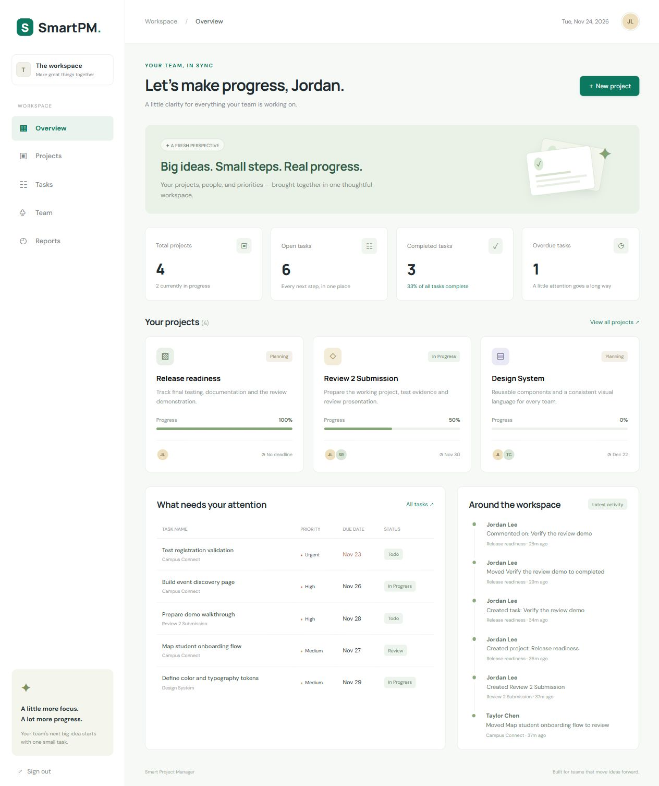

# Smart Project Manager

A working Java web application for planning projects, assigning tasks, tracking progress, and collaborating through role-based workspaces. Built with Java, JDBC, Servlets, JSP, Firebase Authentication, and MySQL. An isolated H2 demo lets reviewers run the complete workflow without external accounts.



## What works

- Create, edit, and delete projects; track planning, in-progress, on-hold, and completed states.
- Add registered users to projects and remove members. Removing a member unassigns their tasks.
- Create, edit, assign, prioritize, and delete tasks. Track to-do → in-progress → review → completed.
- Switch between task board and list views; search and filter by project, status, and assignee.
- Comment on tasks and follow database-backed project activity.
- See actual completion percentages, overdue work, team workload, and task status reports.
- Rank pending work by priority and deadline; export accessible tasks to CSV.
- Administrators manage application roles; project owners manage their projects; members update only their assigned tasks and comment within accessible projects.

## Run the demo

Install JDK 17 or newer and Maven 3.9 or newer. Ensure `java -version` and `mvn -version` point to the same JDK.

```powershell
git clone https://github.com/priyansh-gahlot/Online-project-management-tool.git
cd Online-project-management-tool
$env:APP_DEMO = "true"
mvn compile exec:java
```

On macOS/Linux, use `APP_DEMO=true mvn compile exec:java`.

Open [http://localhost:8080](http://localhost:8080). Choose **Administrator**, **Project manager**, or **Team member** in the demo panel. The sample people and projects are fictional.

Demo changes persist in `data/smartpm.mv.db` between restarts. The development runner listens on loopback only. Demo mode defaults to **false** and refuses MySQL connections; keep the demo database separate from real user data. Set `PORT` to use a different port.

### Five-minute walkthrough

1. Enter as **Project manager** and create a project.
2. Open the project and add **Sam Rivera** to its team.
3. Create a high-priority task, assign it to Sam, and choose a deadline.
4. Sign out and enter as **Team member**. Find the assigned task, update its status, and post a comment.
5. Return as manager. Check project progress, activity, Team workload, and Reports.
6. Export a task report. Enter as administrator to inspect application roles.

## Firebase + MySQL setup

1. Create a MySQL 8 database:

   ```sql
   CREATE DATABASE smart_project_manager CHARACTER SET utf8mb4 COLLATE utf8mb4_unicode_ci;
   ```

2. Set server environment variables (PowerShell example):

   ```powershell
   $env:APP_DEMO = "false"
   $env:DB_URL = "jdbc:mysql://localhost:3306/smart_project_manager"
   $env:DB_USER = "your_database_user"
   $env:DB_PASSWORD = "your_database_password"
   $env:FIREBASE_SERVICE_ACCOUNT_PATH = "C:/secure/firebase-service-account.json"
   ```

3. Enable Email/Password authentication in your Firebase project and authorize your application domain. Update the public web configuration in `src/main/webapp/assets/js/firebase-config.js` to match that Firebase project.
4. Store the Firebase service-account JSON **outside the repository** at the configured path. The application does not bundle a private key.
5. Run `mvn clean verify`, then deploy `target/smart-project-manager.war` to **Tomcat 9**. This application uses `javax.servlet`; Tomcat 10+ uses a different API. The schema is initialized at startup; the database account needs permission to create missing tables. `database/schema.sql` is also supplied for manual setup.
6. Open `/smart-project-manager/login.jsp` on your Tomcat host and register a user. A new account starts as MEMBER. Bootstrap the first administrator directly in your own database:

   ```sql
   UPDATE users SET role = 'ADMIN' WHERE email = 'your_registered_email';
   ```

7. As administrator, promote a registered teammate to PROJECT_MANAGER. Managers can then create projects and invite existing registered accounts.

Use HTTPS for a hosted installation and configure Tomcat's session cookie as Secure and SameSite=Lax. The development runner is for local review. Environment variables are read directly; `.env` files are not automatically loaded.

**Credential remediation:** an earlier repository revision contained a Firebase service-account private key. It has been removed from the current source. Revoke that old key in Google Cloud/Firebase and provision a replacement outside Git. Deleting a file does not remove it from existing Git history.

## Architecture and database

```text
Browser (JSP shell + JavaScript UI)
  → AuthFilter (session, fresh user role, CSRF)
  → ApiServlet
  → ProjectService (validation, project access, transactions)
  → JDBC → MySQL / isolated H2 demo
```

| Table | Purpose |
| --- | --- |
| users | Firebase identity, display name, application role |
| projects | Description, dates, lifecycle state |
| project_members | Project ownership and team access |
| tasks | Assignment, priority, status, deadlines |
| task_comments | Project-scoped task conversations |
| activity_logs | Project and task change history |

Projects own memberships, tasks, comments, and activity through foreign-key relationships. A write and its activity entry commit in one transaction. Project row locks serialize related changes. SQL values use prepared statements; the UI escapes user-entered text. Private Firebase UIDs are not included in the workspace response.

Project completion is `completed tasks / all project tasks × 100`; it is zero for a project without tasks. A project's lifecycle status is set explicitly and does not change automatically when tasks are completed.

Smart priority score is `priorityWeight × 10 + max(0, 14 - daysUntilDeadline) × 3`. LOW/MEDIUM/HIGH/URGENT weights are 1/2/3/4; tasks without a deadline receive no urgency bonus. Completed tasks are excluded. Workload above five open tasks suggests a review; this is a transparent heuristic, not an AI prediction.

### Main source files

- `service/ProjectService.java`: project/task operations, permissions, validation, JDBC transactions.
- `servlet/ApiServlet.java`: workspace data, write endpoints, CSV export.
- `filter/AuthFilter.java`: session checks and CSRF enforcement.
- `util/DatabaseSetup.java`: schema initialization and opt-in demo fixtures.
- `assets/js/workspace.js`: navigation, project forms, board, comments, and reports.
- `assets/css/workspace.css`: responsive workspace styling.

## Tests and build

```sh
mvn clean verify
node --check src/main/webapp/assets/js/workspace.js
node --check src/main/webapp/assets/js/auth.js
```

The automated suite covers project/task lifecycles, rollback on invalid assignments, project isolation, assignee permissions, membership removal, role restrictions, hostile input, real HTTP sessions, CSRF, context paths, demo-mode gating, scoped report downloads, and CSV escaping.

The H2 and embedded-Tomcat tests run without Firebase or MySQL credentials. An additional MySQL integration test runs when `MYSQL_TEST_URL` is set, using `MYSQL_TEST_USER` and `MYSQL_TEST_PASSWORD` against a dedicated test database. GitHub Actions provisions MySQL 8 and runs `mvn verify`, then uploads the WAR.

Firebase login requires a valid replacement service account and a matching Firebase web project. Live Firebase authentication is not exercised by the credential-free test suite. The interface refreshes data after writes and on page reload; live push notifications and file attachments are outside this implementation.

See [review evidence](docs/review-evidence.md) for the implemented review scope and validation record.
